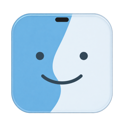

# Notch Finder

Browse files, preview documents with Quick Look, and reuse clipboard items from a panel that opens beneath your MacBook’s notch.

Requires macOS 14 Sonoma or later. A notch is optional. The interface is available in English, Traditional Chinese, Simplified Chinese, and Japanese.

## Install

The prebuilt DMG requires an Apple Silicon Mac running macOS 14 Sonoma or later.

[Download the latest DMG for Apple Silicon](https://github.com/chenghsj/NotchFinder/releases/latest/download/NotchFinder-arm64.dmg) and open it in Finder.

You can also download and open the latest DMG from Terminal.

```sh
dmg="$HOME/Downloads/NotchFinder-arm64.dmg"
curl -fL -o "$dmg" \
  "https://github.com/chenghsj/NotchFinder/releases/latest/download/NotchFinder-arm64.dmg" &&
  open "$dmg"
```

1. Drag **Notch Finder** from the disk image to **Applications**, then eject the disk image.
2. Open **Notch Finder** from **Applications**.

### Open for the first time

The app uses an ad hoc signature. If macOS displays a verification warning, confirm that the DMG came from this project's GitHub Releases before proceeding.

1. After trying to open Notch Finder, go to **System Settings → Privacy & Security**.
2. Scroll to **Security**, choose **Open Anyway**, and confirm when prompted. [Apple's instructions](https://support.apple.com/en-us/102445)

### Software updates

When upgrading from v0.1.1 or earlier, install the DMG manually once to get in-app updates. In **Settings → General → Software Updates**, enable automatic checking and downloading, then enable **Automatically Install Updates** to install a verified update the next time you quit Notch Finder. With automatic installation turned off, automatic downloads go to Downloads.

## Features

- Browse folders in tabs, each with its own back and forward history. Switch between Icon, List, Column, and Gallery views. Expand folders inline in List view, select a folder to browse its contents in the next column, or select a thumbnail to preview a file in Gallery.
- Open Recents, Downloads, iCloud Drive, and mounted drives from the sidebar. Drag a folder into Favorites to keep it handy.
- Preview files and folder contents with Quick Look. Drag files into other apps or use the context menu to copy, rename, or move them to Trash.
- Search and preview text, images, and files from the clipboard. Copy items back to the clipboard, paste text or images into the previous app, or paste files into the current folder.
- Install an app from a mounted disk image using **Install in Applications** in its context menu. In **Settings → File Browser**, you can choose to eject the volume and move the `.dmg` to Trash after installation.
- Resize the panel by dragging its sides or bottom corners. Adjust the interface size, theme, accent color, and hover behavior in Settings. The panel respects the macOS Reduce Motion setting.

## Build from source

Building requires a Swift 6 toolchain and the macOS 27 SDK or later. Use an Xcode or Command Line Tools installation that includes this SDK, then run the following from the repository root.

```sh
./script/build_and_run.sh
```

The script builds, signs, and opens `dist/NotchFinder.app`. Run `./script/build_and_run.sh --build` to build the app bundle without opening it.

To package the app in the drag-to-Applications DMG, run these commands from the repository root with `uv` installed.

```sh
NOTCH_FINDER_BUILD_CONFIGURATION=release ./script/build_and_run.sh --build
uvx --from dmgbuild==1.6.7 dmgbuild -s script/dmg_settings.py \
  -D app=dist/NotchFinder.app "Notch Finder" dist/NotchFinder-preview.dmg
```

### Prepare a signed update

1. Build the app with its release version and a build number higher than the last published build. Set `NOTCH_FINDER_VERSION` and `NOTCH_FINDER_BUILD_NUMBER` in the environment when running `./script/build_and_run.sh --build`. Name the packaged DMG `NotchFinder-VERSION-arm64.dmg` for an Apple Silicon build.
2. From the release maintainer's Mac, run `SPARKLE_BIN_DIR=/path/to/sparkle/bin bash script/sign_preview_update.sh dist/NotchFinder-VERSION-arm64.dmg`. Use the signing tools from the pinned Sparkle release. The script uses the `local.notchfinder.preview` key in the login Keychain and produces the detached DMG signature and the signed `updates/preview.xml` feed.
3. Create a draft GitHub Release for the matching tag. Run the upload command printed by the signing script to attach the versioned DMG, its `.sig` file, and the identical `NotchFinder-arm64.dmg` used by the latest download link. Publish the release, then publish the generated `updates/preview.xml` on `main`.

## Usage

1. Hover just below the notch to open the panel. If none of your displays has a notch, hover at the top center of the main display. You can also press `⌃⌥N` or choose **Show File Panel** from the menu bar icon.
2. Double-click a file or folder to open it, or select it and press Space to preview it. Press Space again or Esc to close the preview.
3. Move the pointer away to let the panel close, or click the pin in the toolbar to keep it open.

Use **Settings → General → Interface Language** to change Notch Finder’s language. Changes take effect immediately. The default follows macOS’s language preference for the app.

To quit Notch Finder, choose **Quit Notch Finder** from **Settings → General** or from the menu bar icon.

### Keyboard shortcuts

| Action | Default shortcut |
| --- | --- |
| Toggle the panel from any app | `⌃⌥N` |
| Pin or unpin the panel | `⌘⇧P` |
| Search the current file or clipboard view | `⌘F` or `⌘K` |
| Quick Look | `Space` |
| New tab / Close tab | `⌘T` / `⌘W` |
| Next tab / Previous tab | `⌃⇥` / `⌃⇧⇥` |
| Go to Folder | `⌘⇧G` |
| Open Settings | `⌘,` |

Change key bindings in **Settings → Keyboard Shortcuts**.

## Permissions and clipboard history

- If macOS blocks access to Trash or another protected folder, go to **Settings → File Browser → Permissions** and click **Open System Settings…** to add Notch Finder to **Full Disk Access**. You can choose **Later** when prompted at launch.
- macOS may ask for permission to read the clipboard. Pasting directly into a previous app may also require **Accessibility** permission. Select **Copy** to paste manually.
- Clipboard history is off by default. Turn on **Record History** in **Settings → Clipboard** to keep a local history on your Mac. You can change the retention period or select **Clear History** at any time. The app skips items marked as concealed, temporary, or automatically generated by their source app.

## Development

Notch Finder uses Swift, SwiftUI, AppKit, and Swift Package Manager. To run the test suite, use the command below.

```sh
swift test
```

The build script uses the Apple Development identity in your keychain if there is exactly one available. It otherwise signs the bundle ad hoc. Set `NOTCH_FINDER_SIGNING_IDENTITY` to use a specific identity across rebuilds.

For interactive UI testing, run `./script/build_and_run.sh --test` and press Enter in the terminal when finished. Add `--settings` to start in Settings. For automated checks, pass the check command after `--`. It receives `NOTCH_FINDER_TEST_APP_PID` and `NOTCH_FINDER_TEST_APP_BUNDLE` in its environment. The test copy quits when the check command exits or the session is interrupted.

Run `./script/build_and_run.sh --verify` to check that a test copy launches and then close it automatically.

Test copies skip the menu bar icon so macOS does not keep an entry for each temporary app in System Settings.

See the [feature specification and manual testing checklist](docs/notch-finder-spec.md) (Traditional Chinese).
